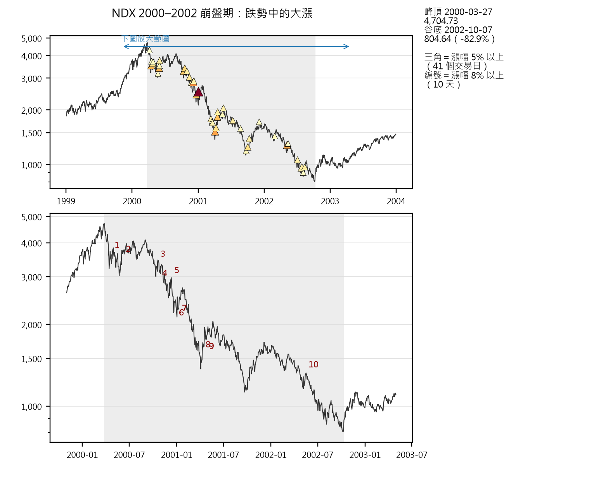
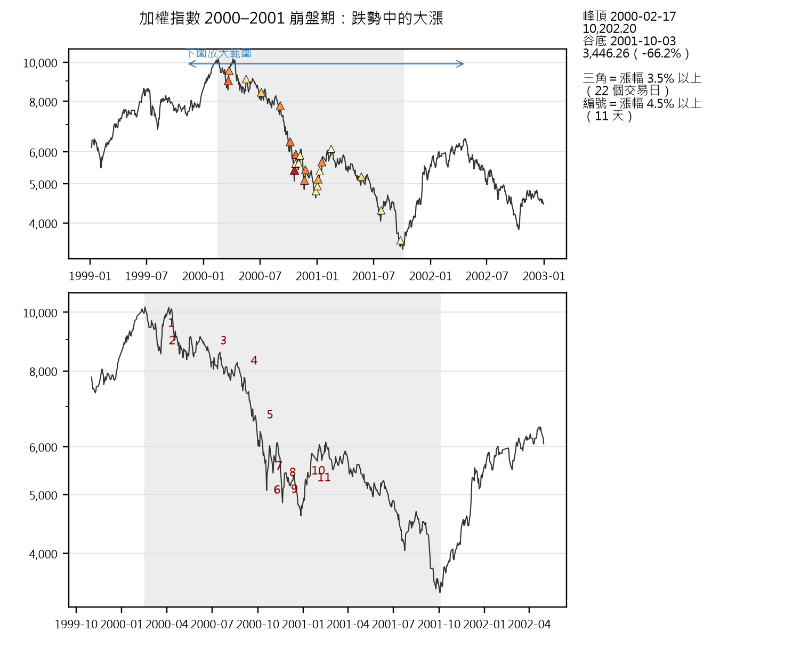
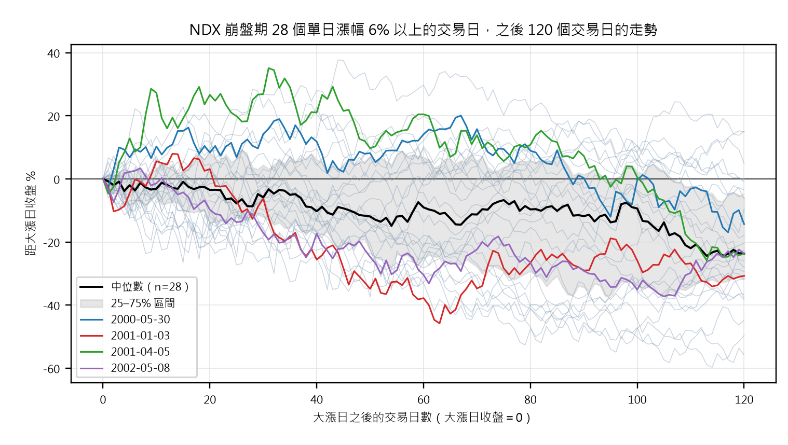

# 跌勢中的大漲：dot-com 循環的對照清單

**報告日期**：2026 年 11 月 24 日

**資料截至**：美股 2026-11-23 收盤；台股 2026-11-24 盤中（台北時間 12:10 抓取，收盤前）。歷史價格為 Yahoo Finance 日收盤。

**觸發問題**：美股與台股在經過一週跌勢之後，因黃仁勳回任輝達執行長而大漲。dot-com 崩跌的那個循環裡，有沒有類似「整體跌勢中大漲」的狀況？什麼時間點？發生了什麼事？後來呢？

**與前兩份報告的關係**：本報告回答的是「歷史對照」問題，**不改動**《量化類比推論報告》（11/8）與《更新報告》（11/21）的任何機率數字。那兩份報告的「終點深度」定義為 24 個月內的最大回檔，已經發生的回檔不會因為反彈而變淺；本報告提供的是另一把尺——**反彈本身在歷史上的命運**。

**方法一句話**：把「跌勢中的大漲」定義為「收盤價單日漲幅超過門檻的交易日」（NDX 5%、加權指數 3.5%、Cisco 10%），逐一記錄它之後的走勢：再漲多少、何時跌破反彈前的低點。價格數字全部由 `quant/scripts/build_bear_rallies.py` 產生；「發生了什麼事」以當日媒體報導為準（主要是 CNN 當天《Moneyline》節目的逐字稿，加上 LA Times、CNET、Taipei Times），不用事後回憶。

**白話結論**：有，而且很多。NDX 在 2000–2002 的崩盤裡有 **41 個單日漲幅 ≥5% 的交易日（24 波）**，台股 2000–2001 有 **22 個（12 波）**——合計 63 個大漲日，**事後全部再跌破反彈前的低點**。型態與今天最接近的，是「龍頭股一句話、全市場跟著大漲」的那幾天：Intel 財測（2001-04-18，NDX +9.5%）、Dell 重申財測（2001-04-05，+10.8%）、Cisco 執行長談話（2002-05-08，+10.6%）、Microsoft 營收預告（2001-07-12，+6.6%）——沒有一次是底。那幾天電視上都有知名分析師說「最壞的情況過去了」；真正落底後的第一個大漲日（2002-10-10），同一個節目的說法反而是「我們還不知道」。

# 核心結論（先讀這節）

**一句話版本**：dot-com 循環裡「跌勢中大漲」出現了 63 次，規模最大的幾次單日漲幅與今天同級甚至更大（NDX 單日 +10% 到 +19%），事後看**沒有一次是底**；多數在 20 個交易日內就破底，走得最遠的三波各漲了三到五成，仍然失敗。不過這是「事後已知是崩盤」的統計，不能直接拿來預測今天——以指數而論，NDX 反彈前的深度（−19.8%）在歷史上「破底／不破底」各半；跌得更深的市場與個股（台股反彈前 −27.7%、NVDA −47.5%），歷史再破底的機率才明顯偏高。

## 1. 「跌勢中的大漲」是常態：NDX 24 波、台股 12 波

| | NDX 2000-03-27 → 2002-10-07 | 加權指數 2000-02-17 → 2001-10-03 |
|---|---|---|
| 峰頂到谷底 | −82.9%，30.4 個月 | −66.2%，19.5 個月 |
| 大漲日（單日漲幅門檻） | 41 天（≥5%） | 22 天（≥3.5%） |
| 分成幾波 | 24 波 | 12 波 |
| 事後再跌破反彈前的低點 | **41 / 41** | **22 / 22** |
| 第一個大漲日之後的中位數再漲幅 | +3.4% | +1.6% |
| 中位數撐多久就破底 | 9 個交易日 | 22 個交易日 |
| 20 個交易日內破底 | 16 波 | 4 波 |
| 60 個交易日內破底 | 21 波 | 11 波 |
| 走得最遠的一波 | 自 2001-09-24 再漲 +44.5%，179 個交易日後破底 | 自 2000-12-28 再漲 +27.2%，128 個交易日後破底 |
| 谷底之後第一個不再破底的大漲日 | 2002-10-10（+5.2%） | 2001-10-11（+4.7%） |

把門檻從 3% 調到 10%，結論不變：任何門檻下，崩盤期間的大漲日都是 100% 再破底（第六節穩健度表）。

## 2. 規模與今天最接近的六天：當天怎麼說、後來怎麼樣

| 日期 | 發生了什麼事（當日報導） | NDX 當日 | 當天的說法 | 之後 |
|---|---|---|---|---|
| 2000-04-17 | 上週創紀錄跌幅後的「搶便宜狂潮」 | +10.0% | CNN：「還是有很多市場觀察者警告，這波反彈可能是假起步」 | 再漲 +8.5% 到 5/01；25 個交易日後破底；一年後 −53% |
| 2000-12-05 | 葛林斯潘談話暗示升息告一段落、必要時降息 | +11.7% | Lehman Brothers 經濟學家：「他說的正是市場想聽的話」 | 再漲 +4.2% 到 12/11；10 個交易日後破底；一年後 −41% |
| 2001-01-03 | Fed 美東下午 1:15 突襲降息 2 碼 | +18.8% | C.E. Unterberg Towbin：「底部顯然已經出現」；Lehman Brothers：「毫無疑問我們已經落底」 | 再漲 +8.0% 到 1/23；32 個交易日後破底；一年後 −35% |
| 2001-04-05 | Dell 重申將達成第一季財測、Alcoa 財報優於預期 | +10.8% | UBS Warburg：「這是絕佳的買點，我 25 年職涯所見最好的之一」 | 再漲 +35.1% 到 5/21；106 個交易日後破底；一年後 −10% |
| 2001-04-18 | Intel 正面財測，加上 Fed 上午 10:55 再度突襲降息 | +9.5% | Goldman Sachs 的 Abby Joseph Cohen：「股市最壞的情況已經過去」 | 再漲 +12.1% 到 5/21；98 個交易日後破底；一年後 −26% |
| 2002-05-08 | Cisco 財報與執行長 John Chambers 的談話 | +10.6% | CNN：「有位交易員跟我說，這我們以前看過」 | 再漲 +3.4% 到 5/17；17 個交易日後破底；一年後 −10% |

（「一年後」＝大漲日收盤之後 250 個交易日的 NDX 報酬；「破底」＝收盤跌破大漲日前 20 個交易日的最低收盤。）

## 3. 後來呢：16 波在 20 個交易日內破底，3 波走遠，0 波成功

- 24 波全部失敗：16 波在 20 個交易日內破底，21 波在 60 個交易日內，23 波在 120 個交易日內。
- 走得最遠的三波——2000-05-24 起（再漲 +28.9%，98 個交易日後破底）、2001-04-05 起（+35.1%，106 個交易日）、2001-09-24 起（+44.5%，179 個交易日）——反彈幅度都很大，但高點一波比一波低：反彈高點距峰頂從 −12.9%（2000-09-01）降到 −42.0%（2001-01-23）、−56.4%（2001-05-21）、−63.4%（2001-12-05）、−77.7%（2002-08-22），最後是谷底 −82.9%（2002-10-07）。
- 以大漲日收盤進場：41 天的 60 個交易日後報酬中位數 −2.1%、一年後 −35.8%；只看每波首漲日則為 −13.1% 與 −33.0%（第六節）。

## 4. 真正的底長什麼樣

- NDX 谷底是 2002-10-07 的 804.64（−82.9%），距峰頂 924 天。谷底後第一個不再破底的大漲日是隔天的 10-10（+5.2%）。
- 訊號不在「漲多大」：這一天的漲幅比崩盤期間 41 個失敗大漲日中的 37 個都小。真正不同的是深度（−82.9%）與時間（第 30 個月）。
- 語氣也不同。CNN 當天提醒觀眾：「我們可以享受一個 250 點的反彈，誰不要呢？但要把它放在更大的脈絡裡看。」三個交易日後（10-15，NDX +5.5%）被問到空頭市場是否結束，答案是：「我們還不知道。」

## 5. 台股的版本

- 加權指數 2000–2001 的 22 個大漲日、12 波，同樣全部再破底；撐最久的一波是 2000-12-28 起的年底行情（再漲 +27.2%，128 個交易日後才破底）。
- 兩次大漲都與國安基金有關。第一次進場（2000-03-16～03-20）之後，指數兩週內幾乎收復全部跌幅（4/05 收 10,186，距高點 −0.2%），24 個交易日後破底。第二次進場（2000-10-03～11-15）期間 10/20 單日 +6.4%、反彈 +19.8%；**基金退場後 3 個交易日（11/20），指數單日 −9.46% 創新低**。
- 與今天的對照：國安基金第十次進場自 11/09 起。進場後第一個大漲日（11/09，+4.9%）在 8 個交易日後破底，低點是 11/20——與 2000 年第二次護盤「進場後第 12 個交易日見低點、隔天跳空大漲」的節奏相近。這只是一個觀察，不是統計。

## 6. 但是——這不能直接拿來預測今天

- **事後選取**：在「事後已知是崩盤」的區間裡統計，每一波當然都會破底。「63 / 63」描述的是 dot-com 循環，本身不是預測。
- **跨歷史基礎率**（NDX 1985 年起，不分多空）：大漲前距高點 −15～−25% 的 6 個先例中，3 個在 60 個交易日內破底、3 個沒有，60 個交易日後報酬中位數 +17.7%——今天的 NDX 就在這個「各半」的深度帶。跌到 −25% 以下的先例，60 個交易日內再破底的比例是 73%，−40% 以下是 75%。
- **個股層級**：Cisco 在它的崩盤期有 12 個單日漲幅 ≥10% 的日子，全部再破底；今天 NVDA 的 +31.5% 規模比其中任何一天都大，但規模在 Cisco 的例子裡沒有提供保護。

## 7. 可檢驗的三句話（對照尺，非方向預測；可逐條計分）

1. **20 個交易日後（2026-12-22）**：NDX 收盤是否低於 25,028.98（11/20 收盤）；dot-com 的 24 波裡 16 波在期限內破底。
2. **60 個交易日後（2027-02-22）**：NDX 是否仍高於 25,028.98。只有 3 波撐過這個期限，後來仍全部失敗。
3. **NVDA**：收盤是否跌破 125.53（11/20 收盤）。dot-com 期 NVDA 型個股的大漲日全部再破底。

# 一、今天發生什麼事：資料確認

| 標的 | 11/20 收盤 | 前一週 | 最新 | 自低點反彈 | 距峰頂（前 → 後） |
|---|---|---|---|---|---|
| NDX | 25,028.98 | −10.8% | 26,746.10（11/23） | +6.9% | −19.8% → −14.3% |
| 那斯達克綜合 | 22,617.73 | −10.4% | 24,089.56（11/23） | +6.5% | −18.1% → −12.7% |
| S&P 500 | 6,910.39 | −8.9% | 7,237.17（11/23） | +4.7% | −11.6% → −7.4% |
| 費城半導體 | 8,408.59 | — | 9,588.05（11/23） | +14.0% | −42.5% → −34.5%（距 6/22 高點） |
| NVDA | 125.53 | −24.8% | 165.05（11/23） | +31.5% | −47.5% → −31.0% |
| 加權指數 | 36,033.29 | −10.5% | 40,136.82（11/24 盤中） | +11.4% | −27.7% → −19.4% |

（「前一週」＝大漲日之前 5 個交易日的漲跌；「自低點反彈」＝自 11/20 收盤的反彈幅度；「距峰頂（前 → 後）」＝反彈前 → 反彈後；台股以 11/24 計。台股 11/23 先漲 +2.2%，11/24 盤中再漲 +9.0%。）

事件本身（一手來源）：

- NVIDIA 新聞稿（2026-11-23）：董事會「一致決議」恢復黃仁勳的總裁、執行長及董事職務，即刻生效；「董事會在決策過程中聽取了美國政府高層的意見，並據此確信黃仁勳的回任不構成國家安全風險」；獨立董事組成的調查委員會「將繼續調查到結束」；董事會並新設「國家安全與出口管制委員會」、開始尋找首席合規長。Colette Kress 續任財務長。
- CNBC（美東 11/23 上午 8:59 發稿，即美股開盤前）：黃仁勳 11 月中請辭後約十天回任；川普表示曾「直接與間接」與董事會談過；馬斯克等人公開力挺；董事會與黃仁勳的洽談從週六開始、週日會議做成決定。NVDA 當天收漲 31%。黃仁勳 12/1 仍將接受國會閉門約談、12/3 公開作證。
- NVDA 的 +31.5% 是它上市以來第三大單日漲幅（前兩名：2000-03-07 +42.4%、2003-05-09 +33.1%）。

換句話說：這是「不確定性解除」型的利多——市場在 11/12 到 11/20 之間對 key-man 風險定的價，在一天之內收回了一部分。

# 二、NDX 崩盤期的 24 波「跌勢中的大漲」

定義：大漲日＝NDX 收盤單日漲幅 ≥5%；同一波＝兩個大漲日之間沒有出現更低的低點，且間隔不超過 10 個交易日；破底＝收盤跌破「第一個大漲日之前 20 個交易日的最低收盤」。

各欄讀法：首漲日＝每波的第一個大漲日；單日＝該日的 NDX 漲幅；前一日距峰頂＝首漲日前一個交易日收盤距峰頂；波內最大單日＝同一波裡漲幅最大的一天（只有一天時標「同左」）；反彈高點（再漲）＝破底之前的最高收盤日，括號內是自首漲日收盤再漲的幅度；撐了（交易日）＝首漲日到破底日的交易日數。

| # | 首漲日 | 單日 | 前一日距峰頂 | 波內最大單日 | 反彈高點（再漲） | 破底日 | 撐了（交易日） |
|---|---|---|---|---|---|---|---|
| 1 | 2000-04-07 | +5.0% | −13.1% | 同左 | 無（當日即是高點） | 2000-04-10 | 1 |
| 2 | 2000-04-17 | +10.0% | −31.8% | 2000-04-17 +10.0% | 2000-05-01（+8.5%） | 2000-05-23 | 25 |
| 3 | 2000-05-24 | +5.2% | −35.7% | 2000-05-30 +10.1% | 2000-09-01（+28.9%） | 2000-10-12 | 98 |
| 4 | 2000-10-13 | +9.1% | −36.1% | 2000-10-13 +9.1% | 2000-10-20（+5.5%） | 2000-11-10 | 20 |
| 5 | 2000-11-14 | +7.2% | −39.7% | 同左 | 2000-11-15（+1.2%） | 2000-11-20 | 4 |
| 6 | 2000-11-24 | +6.1% | −43.3% | 同左 | 2000-11-27（−2.1%） | 2000-11-28 | 2 |
| 7 | 2000-12-05 | +11.7% | −45.7% | 2000-12-05 +11.7% | 2000-12-11（+4.2%） | 2000-12-19 | 10 |
| 8 | 2000-12-22 | +9.5% | −52.7% | 同左 | 2000-12-28（+1.2%） | 2001-01-02 | 5 |
| 9 | 2001-01-03 | +18.8% | −54.8% | 同左 | 2001-01-23（+8.0%） | 2001-02-20 | 32 |
| 10 | 2001-03-13 | +6.5% | −64.3% | 同左 | 2001-03-14（−2.5%） | 2001-03-16 | 3 |
| 11 | 2001-03-19 | +5.0% | −65.0% | 同左 | 無（當日即是高點） | 2001-03-20 | 1 |
| 12 | 2001-03-22 | +6.0% | −65.9% | 同左 | 2001-03-27（+2.0%） | 2001-03-28 | 4 |
| 13 | 2001-04-05 | +10.8% | −70.9% | 2001-04-05 +10.8% | 2001-05-21（+35.1%） | 2001-09-06 | 106 |
| 14 | 2001-05-16 | +5.7% | −61.8% | 2001-05-21 +6.5% | 2001-05-21（+8.1%） | 2001-06-14 | 20 |
| 15 | 2001-07-12 | +6.6% | −65.1% | 同左 | 2001-07-13（+0.1%） | 2001-07-24 | 8 |
| 16 | 2001-08-24 | +5.5% | −68.2% | 同左 | 2001-08-27（−0.1%） | 2001-08-30 | 4 |
| 17 | 2001-09-24 | +5.7% | −76.0% | 2001-10-03 +7.8% | 2001-12-05（+44.5%） | 2002-06-11 | 179 |
| 18 | 2001-12-05 | +5.3% | −65.3% | 同左 | 2001-12-06（−0.2%） | 2002-01-22 | 31 |
| 19 | 2002-03-01 | +5.6% | −71.1% | 同左 | 2002-03-08（+8.3%） | 2002-04-09 | 26 |
| 20 | 2002-05-08 | +10.6% | −75.4% | 2002-05-08 +10.6% | 2002-05-17（+3.4%） | 2002-06-03 | 17 |
| 21 | 2002-07-05 | +6.5% | −78.8% | 同左 | 2002-07-08（−4.4%） | 2002-07-10 | 3 |
| 22 | 2002-07-24 | +6.1% | −80.9% | 同左 | 無（當日即是高點） | 2002-07-25 | 1 |
| 23 | 2002-07-29 | +6.5% | −80.6% | 同左 | 2002-07-30（+1.1%） | 2002-08-02 | 4 |
| 24 | 2002-08-06 | +5.2% | −81.8% | 2002-08-14 +6.7% | 2002-08-22（+16.3%） | 2002-09-23 | 33 |

讀法：

- 第 1 波（2000-04-07）是 NDX 距峰頂還不到 −15% 時的唯一一次大漲，下一個交易日就破底，四天後（4/14）指數已經 −31.8%。
- 「撐了（交易日）」一欄的中位數是 9；超過 20 個交易日的只有 8 波。
- 「波內最大單日」顯示大漲經常成群出現：2000-05、2001-04 各有 4 個大漲日擠在同一波裡。

# 三、每一波的故事：時間點、發生了什麼事、後來呢

以下按時間順序。每一波的「發生了什麼事」取自當日 CNN《Moneyline》逐字稿（另註明者除外），引號內為原文的中文翻譯；點位一律換算成距 2000-03-27 峰頂的百分比。

## 2000 年 4 月：三週內從 −13% 殺到 −32%，再反彈兩成

- **4/04（二）** 那斯達克綜合指數盤中最深跌 574 點，收盤只跌 74.79 點（−1.8%）。CNN：「投資人在午後進場，逢低買進。」Merrill Lynch 的 Dick McCabe：「市場很可能已經做出一個中期低點……之後還會回頭再測這個盤中低點。」
- **4/07（五）** 就業報告「對市場友善」加上跌深搶便宜，綜合指數 +178 點（+4.2%）收 4,446，CNN 標題是「Nasdaq Scores Biggest Point-Gain Ever」；從週二低點到這天收盤，那斯達克反彈 22%。NDX +5.0%，距峰頂 −8.8%。
- **之後**：下一個交易日就破底；4/14 NDX 收 3,208（−31.8%），單日 −9.7%，是整個崩盤期最大的單日跌幅。
- **4/17（一）** CNN 的 Rhonda Schaffler：「一個非常震盪的交易日，變成了一場搶便宜狂潮，投資人至少今天先甩開上週的大賣壓。」綜合指數 +217 點（+6.6%），「創下當時最大單日漲點，而前一個交易日才剛寫下最大單日跌點」。NDX +10.0%。同集的 Greg Clarkin：「還是有很多市場觀察者警告這波反彈可能是假起步。」
- **後來呢**：再漲到 5/01（+8.5%，距峰頂 −18.6%），5/23 破底（−35.7%）。

## 2000 年 5–9 月：整個崩盤最長的一波，+36%，撐了三個半月

- **5/23** NDX 收 3,023（−35.7%）。**5/24** Intel 大漲，CNN 說 Intel 一檔就貢獻了道瓊將近四成的漲點；NDX +5.2%。
- **5/30**（陣亡將士紀念日後第一個交易日）CNN：「連續將近兩週的賣壓之後，華爾街已經蓄勢待發——空單回補、觀望買盤，加上對科技股的樂觀評論，引爆一波強勁反彈，只是量能不大。」NDX +10.1%。New Millennium Advisors 的 Michael Carty：「我認為那斯達克這一波的底已經出現了。」Gruntal 的 Joseph Battipaglia：「這波反彈是真的。」
- **6/01 +5.9%、6/02 +6.7%**。
- **後來呢**：7/17 收 4,062（−13.7%），9/01 收 4,099（−12.9%），自 5/23 低點 +35.6%。10/12 破底（−36.1%）；2000 年年底 NDX 2,342（−50.2%）；自 5/24 大漲日起一年後 −35.8%。

## 2000 年 10–11 月：財報週反彈與兩次一天的反彈

- **10/12** NDX 收 3,004（−36.1%）。**10/13** CNN 的 Allan Chernoff：「是財報疑慮引爆賣壓，也是好消息點燃反彈。」Gateway、PMC-Sierra、Veritas 財報優於預期；Goldman Sachs 的 Abby Joseph Cohen：「S&P 500 看起來低估了大約 15%。」綜合指數 +242 點（+7.9%），NDX +9.1%。Cantor Fitzgerald 的 Bill Meehan：「我不認為這代表底部已經出現。有太多人每天都在猜底。」**之後**：10/20 高點（再漲 +5.5%），11/10 破底（−38.6%）。
- **11/14** 終止六連跌，綜合指數 +171 點（+5.8%），NDX +7.2%；CNN：「投資人覺得 Fed 明天開會時會更擔心經濟降溫太多。」**之後**：4 個交易日後破底（11/20）。
- **11/24**（感恩節後半日交易）U.S. Bancorp Piper Jaffray 的 Mark Donahoe：「我想是撿便宜的人在找有獲利、本益比合理的公司，試著從瓦礫堆裡挑便宜貨。」綜合指數 +149 點（+5.4%），NDX +6.1%。Brown Brothers Harriman 的 Charles Blood 說這「或許是對 10 月低點測試的轉折」。**之後**：2 個交易日後破底（11/28）；12/20 來到 −53.0%。

## 2000 年 12 月～2001 年 1 月：Fed 轉向，一天 +11.7%，一個月後 +18.8%，兩次都不是底

- **12/05** 葛林斯潘在社區銀行家會議演說，暗示升息已近尾聲、經濟走緩時可能降息。CNET：「那斯達克跳漲 274.02 點、10.5%，收 2,889.77，創史上最大單日漲幅紀錄。」NDX +11.7%。Lehman Brothers 的 Drew Matus：「他說的正是市場想聽的話。」同日佛州法官拒絕重新驗票，大選不確定性可望落幕。**之後**：再漲 +4.2% 到 12/11，10 個交易日後破底（12/19，−49.0%）。
- **12/22** CNN 稱之為「聖誕老人行情」：「投資人今天回流，部分是因為樂觀認為企業財測調降潮最壞的情況可能已經過去」，加上「預期葛林斯潘會送出一個遲來的假期禮物——明年初降息」與假期前的空單回補。綜合指數 +176 點（+7.6%），NDX +9.5%。**之後**：5 個交易日後破底（2001-01-02，NDX 單日 −9.1%），隔天就是 Fed 突襲。
- **2001-01-03** Fed 在美東下午 1:15 突襲降息 2 碼。CNN 標題：「Nasdaq Rockets 324.83 to 2,616.69」；LA Times 隔天寫那是「紀錄性的單日漲幅」。NDX +18.8%。C.E. Unterberg Towbin 的 Brian Finnerty：「我認為底部顯然已經出現了。」Lehman Brothers 的 Stephen Slifer：「毫無疑問，我認為我們已經落底……一年後我們會對結果相當滿意。」LA Times 引述 American Express 的 Peter Anderson：「雖然我們已經見到底部，但不會再回到過去的狂熱。」
- **後來呢**：再漲 +8.0% 到 1/23（2,730，−42.0%），2/20 破底（−55.5%）；一年後（250 個交易日）NDX 比大漲日收盤還低 34.7%。

## 2001 年 3 月：三次一天的反彈

- **3/13**（NDX +6.5%）前一天重挫後，盤中走低、尾盤拉回；3 個交易日後破底。
- **3/19**（+5.0%）CNN 的 John Metaxas：「不論你叫它搶便宜還是空單回補」，最後兩小時拉升，Fed 隔天開會；下一個交易日就破底。
- **3/22**（+6.0%）收盤前急拉；4 個交易日後破底。3 月下旬 NDX 已來到 −66% 附近。

## 2001 年 4–5 月：「25 年來最好的買點」，+50% 的反彈，五個月後破底

- **4/04** NDX 收 1,371（−70.9%）。
- **4/05** CNN 的 Kitty Pilgrim：「這是不折不扣的紓困式反彈。」前一天那斯達克才寫下 1998 年 10 月以來的最低收盤；「Dell 率先帶動，向投資人保證將達成第一季財測」，接著 Alcoa 財報優於預期、Yahoo 獲 Lehman Brothers 評等上調。綜合指數 +146 點（+8.9%），「那斯達克史上第三好的單日表現」；NDX +10.8%。UBS Warburg 的 Ed Kerschner：「市場被極度低估。這是一個絕佳的買點，是我 25 年職涯所見最好的之一。」
- **4/10** +7.9%。
- **4/18** CNN：「多虧了 Intel 的好消息，今天原本就已經是好日子」；美東 10:55 Fed 第二度突襲降息，「這項宣布讓買家火力全開」。綜合指數 +156 點（+8.1%）收 2,079，道瓊 +399 點；NDX +9.5%，Intel +20%（Yahoo 調整後收盤）。Goldman Sachs 的 Abby Joseph Cohen：「我們認為股市最壞的情況已經過去，經濟則不一定。」Dreyfus 的 Dick Hoey：「我認為股市已經落底。」同一集節目裡主播提醒：「1 月 3 日那天……我們知道那波反彈沒有續航力。」
- **4/19 +6.7%、5/16 +5.7%、5/21 +6.5%**（5/16 是 Fed 前一日降息後的反應，CNN：「投資人花了將近 24 小時，才決定五個月內五度降息是好事」。）
- **後來呢**：5/21 收 2,053（−56.4%），自 4/04 低點 +49.7%；9/06 破底（1,362，−71.1%，比 4 月低點還低）；自 4/05 大漲日起一年後 −10.3%。

## 2001 年 7–8 月：龍頭股信心喊話

- **7/12** Microsoft 表示當季營收將高於預期，Motorola 財報優於預期，CNN 標題：「Microsoft's Bullish Revenue Outlook Boosts Tech Stocks」。綜合指數 +104 點（+5.3%），NDX +6.6%。**之後**：8 個交易日後破底。
- **8/24** CNN：「投資人顯然很興奮，因為 Cisco 昨晚暗示業務可能已經落底。」綜合指數 +73 點（+4.0%），NDX +5.5%。**之後**：4 個交易日後破底。

## 2001 年 9–12 月：9/11 之後第二長的一波，+53%，八個月後破底

- **9/21** NDX 收 1,127（−76.0%）。
- **9/24** CNN 的 Greg Clarkin：週末沒有重大的軍事發展，「再加上有不少信心喊話——一些策略分析師早上發出非常樂觀的報告」；跌深的大型科技股「蓄勢反彈」。綜合指數 +76 點（+5.3%），「9 月以來第二次收紅」；NDX +5.7%。他也說：「很多交易員對這能不能持續，還是相當懷疑。」
- **10/03** Cisco 執行長 John Chambers 下午表示「對本季目前的財測非常安心」，CNN：「這真的帶動科技股……來到更高的位置。」綜合指數 +88 點（+5.9%）；NDX +7.8%，Cisco +21.5%。
- **10/11 +6.5%、12/05 +5.3%**。CNN 在 12/05：「那斯達克收在四個月新高。」「9 月 21 日以來，那斯達克綜合指數上漲約 43%。」
- **後來呢**：12/05 收 1,721（−63.4%），自 9/21 低點 +52.7%；2002-06-11 破底（−76.6%）；最終谷底（2002-10-07）比 9/24 大漲日的收盤還低 32.4%。

## 2002 年 3 月：「多頭市場已經恢復」

- **3/01** CNN：「3 月的第一天，市場強勁反彈，催化劑是優於預期的製造業報告。」「那斯達克大漲 4%，突破 1,800。」NDX +5.6%。First Albany 的 Hugh Johnson：「今天這個市場傳達了非常強烈的訊息——多頭市場已經恢復。」
- **後來呢**：再漲 +8.3% 到 3/08，4/09 破底（−71.4%）。

## 2002 年 5 月：Cisco 日——型態上最像今天的一天

- **5/07 盤後** Cisco 公布會計年度第三季結果。**5/08** CNN 的 Greg Clarkin：「投資人抓住 Cisco 執行長 John Chambers 略微樂觀的字眼，今天就此引發一陣買盤。」綜合指數 +122 點（+7.8%），道瓊 +305 點；NDX +10.6%；Cisco +24%（CNN）。
- 同一段報導：「這是一年來那斯達克最大的漲幅。但有位交易員跟我說，這我們以前看過。」「質疑者說這有一部分是空單回補……這仍然是個『拿出證明來』的市場。」Lou Dobbs：「以 Cisco 的財報來說，這波反彈很不尋常，因為 Cisco 財報面對的是該公司史上最糟的一季。」
- **5/14** +5.2%。
- **後來呢**：再漲 +3.4% 到 5/17，6/03 破底（−75.4%）；自 5/08 大漲日起一年後 −10.1%。

## 2002 年 7 月：三天大漲，全部四個交易日內破底

- **7/05** CNN：「七四假期沒有發生重大的恐怖攻擊事件，市場今天大漲。」綜合指數 +68 點（+4.9%），NDX +6.5%。3 個交易日後破底。
- **7/24** Adelphia 前高層被上銬逮捕，國會就企業改革法案達成協議；CNN 標題：「Dow Surges 488.95 to 8,191.29; Nasdaq Rises 61.18 to 1,290.23」。NDX +6.1%。Bedford Oak Advisors 的 Harvey Eisen：「這些日子……是紓困式反彈。空單回補，每個人都在問，這是底嗎？一天成不了底。」**隔天（7/25）就破底。**
- **7/29** 道瓊 +447 點，綜合指數 +73 點（+5.8%），NDX +6.5%。CNN 列出的原因包括投資人「週末回來心情比較好」，部分策略分析師提到賓州礦工獲救。UBS PaineWebber 的 Mary Farrell：「我覺得快樂的日子又來了。」「我準備好說，如果不是底，也離底很近了。」同一集也說，「不少老空頭認為這具備空頭市場反彈的所有特徵——又急又令人信服」；當晚觀眾投票，63% 認為市場尚未轉折。**之後**：4 個交易日後破底（8/02），8/05 再創新低（−81.8%）。

## 2002 年 8 月：SEC 認證日，+22% 的反彈，破底之後才見到真正的底

- **8/05** NDX 收 857（−81.8%）。**8/06** CNN：「那斯達克上演 4% 的反彈，部分受 Cisco 幫助」，「投資人喜歡 Fed 可能降息的可能性」。NDX +5.2%。
- **8/14** CNN 的 Jan Hopkins：「投資人鬆了一口氣，因為 SEC 的期限過了，沒有最後關頭的意外。」道瓊 +261 點，綜合指數 +65 點（+5.1%），NDX +6.7%；「今天創造了超過 3,500 億美元的市值」。
- **後來呢**：8/22 高點 1,049（−77.7%），自 8/05 +22.4%；9/23 破底（843，−82.1%）；10/07 谷底 805（−82.9%）。

## 2002 年 10 月：真正的底

- **10/07** NDX 收 804.64（−82.9%），距峰頂 924 天。
- **10/10**（NDX +5.2%，谷底後第一個大漲日）CNN 的 Christine Romans：「投資人買股票，因為今天是空頭市場的第 1,000 天。」她拿 1929–32 年做比較（那段空頭裡約有五波平均 +28% 的反彈），結語是：「所以我們可以享受一個 250 點的反彈，誰不要呢？但要把它放在更大的脈絡裡看。」
- **10/15**（NDX +5.5%）Citigroup、GM、J&J 財報；道瓊 +375 點以上。CNN：「自 2000 年 3 月以來已經有五波大反彈，平均漲幅 18.2%。很多人在說，這可能是第六波空頭市場反彈。」對於空頭市場是否結束：「答案是，我們還不知道。」
- **後來呢**：NDX 到 11 月底反彈到約 1,116（+38.7%），2003 年 2 月回測到 952（仍比谷底高 18%），再展開多頭；804.64 此後到資料截止日沒有再被跌破。

## 整段崩盤的 16 波反彈（波段低點到波段高點）

下表用「一波反彈漲幅 ≥10%」的另一種切法（之字形轉折），看每一段反彈從哪裡漲到哪裡、何時跌破起漲點。16 波全部被跌破。

| # | 起漲日（低點） | 反彈高點 | 幅度 | 交易日 | 大漲日 | 跌破起漲點 | 高點到破底 |
|---|---|---|---|---|---|---|---|
| 1 | 2000-04-14（−31.8%） | 2000-05-01（−18.6%） | +19.4% | 10 | 4 | 2000-05-23 | 16 |
| 2 | 2000-05-10（−31.0%） | 2000-05-16（−22.5%） | +12.4% | 4 | 0 | 2000-05-23 | 5 |
| 3 | 2000-05-23（−35.7%） | 2000-07-17（−13.7%） | +34.3% | 37 | 4 | 2000-10-12 | 62 |
| 4 | 2000-07-28（−26.1%） | 2000-09-01（−12.9%） | +17.9% | 25 | 0 | 2000-10-02 | 20 |
| 5 | 2000-10-12（−36.1%） | 2000-10-20（−26.5%） | +15.0% | 6 | 2 | 2000-11-10 | 15 |
| 6 | 2000-11-30（−46.7%） | 2000-12-11（−36.8%） | +18.6% | 7 | 2 | 2000-12-19 | 6 |
| 7 | 2000-12-20（−53.0%） | 2000-12-28（−47.6%） | +11.5% | 5 | 1 | 2001-01-02 | 2 |
| 8 | 2001-01-02（−54.8%） | 2001-01-03（−46.3%） | +18.8% | 1 | 1 | 2001-02-20 | 32 |
| 9 | 2001-01-05（−51.8%） | 2001-01-23（−42.0%） | +20.4% | 11 | 0 | 2001-02-09 | 13 |
| 10 | 2001-04-04（−70.9%） | 2001-05-21（−56.4%） | +49.7% | 32 | 6 | 2001-09-06 | 75 |
| 11 | 2001-05-30（−62.2%） | 2001-06-07（−58.3%） | +10.4% | 6 | 0 | 2001-06-14 | 5 |
| 12 | 2001-09-21（−76.0%） | 2001-12-05（−63.4%） | +52.7% | 52 | 4 | 2002-06-11 | 128 |
| 13 | 2002-02-21（−71.3%） | 2002-03-08（−66.9%） | +15.3% | 11 | 1 | 2002-04-09 | 21 |
| 14 | 2002-05-07（−75.4%） | 2002-05-17（−71.8%） | +14.4% | 8 | 2 | 2002-06-03 | 10 |
| 15 | 2002-07-02（−79.5%） | 2002-07-05（−77.5%） | +10.1% | 2 | 1 | 2002-07-10 | 3 |
| 16 | 2002-08-05（−81.8%） | 2002-08-22（−77.7%） | +22.4% | 13 | 2 | 2002-09-23 | 21 |

（起漲日與反彈高點括號內＝距峰頂；幅度＝低點到高點的漲幅；交易日＝低點到高點的交易日數；大漲日＝波內大漲日數；高點到破底＝高點到跌破起漲點的交易日數。）

# 四、龍頭股對照：當年的 Cisco、Intel，與今天的 NVIDIA

dot-com 循環裡沒有「龍頭公司創辦人執行長離職又回任」的先例（我沒有找到）。型態上最接近今天的，是**龍頭股釋出利多、全市場一日大漲**的日子：

| 日期 | 龍頭股與事件（當日報導） | 龍頭股當日 | NDX 當日 | NDX 距峰頂 | NDX 多久後破底 |
|---|---|---|---|---|---|
| 2001-04-05 | Dell 保證將達成第一季財測 | Dell +14%（CNN） | +10.8% | −70.9% | 106 個交易日 |
| 2001-04-18 | Intel 正面財測（另有 Fed 突襲降息） | Intel +20% | +9.5% | −64.5% | 98 個交易日 |
| 2001-07-12 | Microsoft 看好當季營收 | — | +6.6% | −65.1% | 8 個交易日 |
| 2001-08-24 | Cisco 暗示業務可能已經落底 | — | +5.5% | −68.2% | 4 個交易日 |
| 2001-10-03 | Cisco 執行長：「對本季財測非常安心」 | Cisco +21.5% | +7.8% | −75.4% | 172 個交易日 |
| 2002-05-08 | Cisco 財報與執行長談話 | Cisco +24% | +10.6% | −75.4% | 17 個交易日 |
| 2002-08-06 | 對 Cisco 財報的樂觀預期 | — | +5.2% | −81.8% | 33 個交易日 |

（「—」＝當日報導未載明個股漲幅；個股漲幅取自 CNN 當日報導或 Yahoo 調整後收盤。）

## Cisco 自己的 12 個大漲日

Cisco 是當時那斯達克的權值王。它從 2000-03-27 高點到 2002-10-08 谷底跌了 −89.3%；期間 12 個單日漲幅 ≥10% 的日子，**全部再破底**：

| 日期 | 單日 | 前 5 日 | 前一日距峰頂 | 之後再漲 | 破底日 | 撐了（交易日） |
|---|---|---|---|---|---|---|
| 2000-04-17 | +16.7% | −26.6% | −28.8% | +7.4% | 2000-05-18 | 22 |
| 2000-10-13 | +12.5% | −14.2% | −37.8% | +3.9% | 2000-10-30 | 11 |
| 2000-10-19 | +11.5% | +3.0% | −34.7% | −1.6% | 2000-10-30 | 7 |
| 2000-10-31 | +12.1% | −14.3% | −40.0% | +5.3% | 2000-11-30 | 21 |
| 2000-12-05 | +13.8% | −10.8% | −42.8% | +5.2% | 2000-12-18 | 9 |
| 2001-01-03 | +24.0% | −20.9% | −58.4% | +3.2% | 2001-02-07 | 24 |
| 2001-03-13 | +13.6% | −19.3% | −76.5% | −2.6% | 2001-03-23 | 8 |
| 2001-05-02 | +12.4% | +9.7% | −77.8% | +17.4% | 2001-09-18 | 92 |
| 2001-05-21 | +13.2% | +6.1% | −74.8% | +2.7% | 2001-09-05 | 74 |
| 2001-10-03 | +21.5% | −8.5% | −85.7% | +56.2% | 2002-09-27 | 248 |
| 2002-05-08 | +24.4% | −11.0% | −83.7% | +6.0% | 2002-07-02 | 38 |
| 2002-07-29 | +12.6% | −13.4% | −85.2% | +0.2% | 2002-08-05 | 5 |

（單日＝當日漲幅；前 5 日＝大漲前 5 個交易日；前一日距峰頂＝大漲前一個交易日收盤距 2000-03-27 高點；之後再漲＝大漲日收盤到破底前最高收盤；撐了＝大漲日到破底日的交易日數。）

## NVDA 今天的位置

- NVDA 的 +31.5% 是上市以來第三大單日漲幅，也是 2003 年 5 月以來最大。前兩名是 2000-03-07（+42.4%，崩盤前）與 2003-05-09（+33.1%，當時已 −77.6%；之後仍在一年多後又創新低）。
- NVDA 自己在 dot-com 崩盤裡的大漲日——2001-01-03 +30.7%、2000-12-22 +25.8%、2000-12-08 +22.8%、2000-04-05 +22.3%——同樣全部再破底。
- 與 Cisco 相比，今天的 NVDA 大漲日規模更大（+31.5%，Cisco 最大是 +24.4%）、位置更淺（−47.5%，Cisco 的 12 個大漲日多數發生在 −75% 以下）。這是差別，但 Cisco 的例子顯示「大漲日的規模」本身不構成落底訊號。

# 五、台股 2000–2001 的對照

加權指數從 2000-02-17 的 10,202.20 跌到 2001-10-03 的 3,446.26（−66.2%，594 天）。期間 22 個單日漲幅 ≥3.5% 的交易日，分成 12 波，**全部再破底**；台股的反彈通常撐得比 NDX 久（中位數 22 個交易日 vs. 9 個），但結局相同。

| # | 首漲日 | 單日 | 前一日距峰頂 | 波內最大單日 | 反彈高點（再漲） | 破底日 | 撐了（交易日） |
|---|---|---|---|---|---|---|---|
| 1 | 2000-03-21 | +5.5% | −16.3% | 2000-03-21 +5.5% | 2000-04-05（+13.1%） | 2000-04-26 | 24 |
| 2 | 2000-05-17 | +4.1% | −14.5% | 同左 | 2000-05-19（+0.4%） | 2000-06-29 | 30 |
| 3 | 2000-07-05 | +4.6% | −21.1% | 同左 | 2000-07-17（+1.9%） | 2000-07-25 | 14 |
| 4 | 2000-09-04 | +5.2% | −27.3% | 同左 | 2000-09-05（−0.2%） | 2000-09-08 | 4 |
| 5 | 2000-10-06 | +5.4% | −40.9% | 同左 | 2000-10-09（−2.3%） | 2000-10-12 | 3 |
| 6 | 2000-10-20 | +6.4% | −50.2% | 2000-10-20 +6.4% | 2000-11-09（+12.7%） | 2000-11-20 | 21 |
| 7 | 2000-11-21 | +5.3% | −52.5% | 2000-11-21 +5.3% | 2000-11-27（+6.5%） | 2000-12-21 | 22 |
| 8 | 2000-12-28 | +4.0% | −54.8% | 2001-01-16 +5.3% | 2001-02-15（+27.2%） | 2001-07-11 | 128 |
| 9 | 2001-02-15 | +3.7% | −42.3% | 同左 | 2001-02-16（−1.0%） | 2001-05-02 | 51 |
| 10 | 2001-05-23 | +4.4% | −51.1% | 同左 | 2001-06-11（+1.2%） | 2001-06-22 | 22 |
| 11 | 2001-07-26 | +4.0% | −59.5% | 同左 | 2001-08-16（+9.0%） | 2001-09-13 | 33 |
| 12 | 2001-09-26 | +3.8% | −65.8% | 同左 | 2001-09-28（+0.3%） | 2001-10-02 | 3 |

## 台股的 5 波反彈（波段低點到波段高點）

用與第三節相同的切法（一波反彈漲幅 ≥10%），5 波全部被跌破。欄位讀法同第三節的表。

| # | 起漲日（低點） | 反彈高點 | 幅度 | 交易日 | 大漲日 | 跌破起漲點 | 高點到破底 |
|---|---|---|---|---|---|---|---|
| 1 | 2000-03-20（−16.3%） | 2000-04-05（−0.2%） | +19.3% | 10 | 2 | 2000-04-26 | 15 |
| 2 | 2000-10-19（−50.2%） | 2000-11-09（−40.3%） | +19.8% | 15 | 5 | 2000-11-20 | 7 |
| 3 | 2000-11-20（−52.5%） | 2000-11-27（−46.7%） | +12.1% | 5 | 2 | 2000-12-21 | 18 |
| 4 | 2000-12-27（−54.8%） | 2001-02-15（−40.2%） | +32.3% | 29 | 6 | 2001-07-11 | 100 |
| 5 | 2001-07-24（−60.4%） | 2001-08-16（−54.1%） | +16.0% | 16 | 1 | 2001-09-13 | 19 |

（起漲日與反彈高點括號內＝距峰頂；幅度＝低點到高點的漲幅；交易日＝低點到高點的交易日數；大漲日＝波內大漲日數；高點到破底＝高點到跌破起漲點的交易日數。）

## 時間點與發生了什麼事

**2000 年 3 月：國安基金第一次進場，指數兩週內幾乎收復全部跌幅。** 國安基金 2000-03-16～03-20 首度進場（投入 542 億元）。兩個大漲日出現在進場結束之後：3/21 +5.5%、3/23 +5.1%；到 4/05 收 10,186，距歷史高點只差 0.2%。Taipei Times 在 4/10 報導：「許多分析師原本預期上週股市會休息一下，因為加權指數自 3 月 20 日以來已經大漲約 1,400 點、16.3%。」同一篇指出，投資人當時擔心的利空是國安基金與四大基金的潛在賣壓；國安基金管理委員會週六開會討論基金操作，「但沒有說明將如何處分它持有的 542 億元股票」。Taiwan International Securities 的 Naiwen Kerr 給出 9,800～10,400 的「保守估計」區間。

**後來呢**：4/26 破底（3/21 之後 24 個交易日）；9/08 −27.8%；10/19 收 5,081（−50.2%）。這次護盤的結案損益是約 −500 億元。

**2000 年 10–11 月：國安基金第二次進場；退場三天後單日 −9.46%。** 基金 10/03～11/15 進場（投入 1,227 億元）。進場後第一個大漲日 10/06（+5.4%）在 3 個交易日後就破底（10/12，−43.1%）；10/19 收 5,081（−50.2%）見到低點，隔天 10/20 +6.4%——整段空頭期最大的單日漲幅，到 11/09 收 6,090（+19.8%）。11/15 基金退場時指數 5,737，結案獲利 +226 億元。**3 個交易日後的 11/20，加權指數單日 −9.46%，收 4,845（−52.5%）創新低**——整段空頭期最大的單日跌幅。接著 11/21、11/24 各 +5.3%，11/27 收 5,434，12/21 又破底（−52.8%）。券商網站 Pocket.tw 的統計：第二次任務起算後第 60 個交易日，台股 −17.96%。

**2000/12/28～2001/02/15：年底行情，+32%，最長的一波。** 12/27 低點 4,615（−54.8%），2/15 收 6,104（−40.2%）；之後 5/02、7/11 陸續破底，7/11 收 4,548（−55.4%）。

**2001 年：三次反彈，一次比一次低。** 5/23（+4.4%）、7/26（+4.0%，到 8/16 +16%）、9/26（+3.8%）；10/03 谷底 3,446（−66.2%）。**10/11 +4.7% 是谷底後第一個不再破底的大漲日**，之後到 2002-04-22 的 6,462（+87.6%）。

| 國安基金進場 | 第一次 | 第二次 |
|---|---|---|
| 啟動日 | 2000-03-15 | 2000-10-02 |
| 進場期間 | 2000-03-16～03-20（5 天） | 2000-10-03～11-15（43 天） |
| 進場時加權指數 | 8,682.76 | 5,805.17 |
| 投入金額 | 542 億元 | 1,227 億元 |
| 結案損益 | −500 億元 | +226 億元 |

（來源：維基百科「國家金融安定基金」歷年績效表——次級來源；2001 年沒有進場紀錄。表中第一次進場日的指數 8,682.76 與本報告的 Yahoo 收盤資料一致。）

## 與今天的對照

國安基金第十次進場自 2026-11-09 起，進行中。進場後第一個大漲日 11/09（+4.9%）在 8 個交易日後破底，低點是 11/20 的 36,033（−27.7%）；台北時間 12:10 盤中 40,137，自低點 +11.4%，距峰頂 −19.4%。節奏與 2000 年第二次護盤相近：進場後第一個大漲日都不是底，低點出現在進場開始後 9 個交易日（2000 年是 12 個），隨後跳空大漲；2000 年那次又漲了 12.7%，21 個交易日後破底。這是一個觀察，不是統計。

# 六、跨歷史基礎率：大跌之後的單日大漲，是不是落底訊號

前五節的統計都落在「事後已知是崩盤」的區間裡。要回答「今天的 NDX 大漲是不是底」，得換一個不分多空的問法：**歷史上每一次『距高點 ≥15% 時出現單日大漲』，之後有沒有再破底？** 只計算每一波的第一個大漲日。

| 系列 | 前一日距高點 | 波數 | 20 日內 | 60 日內 | 120 日內 | 250 日內 | 60 日後 | 250 日後 |
|---|---|---|---|---|---|---|---|---|
| NDX ≥5%，1985 年起 | 全部 | 45 | 56% | 71% | 76% | 78% | −0.6% | +20.9% |
| NDX ≥5%，1985 年起 | −15～−25% | 6 | 33% | 50% | 50% | 50% | +17.7% | +42.9% |
| NDX ≥5%，1985 年起 | −25～−40% | 11 | 54% | 73% | 82% | 82% | +8.1% | +10.7% |
| NDX ≥5%，1985 年起 | −40% 以下 | 28 | 61% | 75% | 79% | 82% | −5.0% | −10.2% |
| 綜合指數 ≥4%，1971 年起 | 全部 | 51 | 53% | 72% | 78% | 82% | +4.1% | +18.5% |
| 綜合指數 ≥4%，1971 年起 | −15～−25% | 9 | 44% | 56% | 56% | 67% | +7.9% | +25.8% |
| 綜合指數 ≥4%，1971 年起 | −25～−40% | 16 | 50% | 75% | 81% | 81% | +11.8% | +23.0% |
| 綜合指數 ≥4%，1971 年起 | −40% 以下 | 26 | 58% | 77% | 85% | 88% | −8.6% | −4.1% |
| S&P 500 ≥4%，1970 年起 | 全部 | 32 | 38% | 56% | 66% | 66% | +5.4% | +20.5% |
| S&P 500 ≥4%，1970 年起 | −15～−25% | 9 | 11% | 33% | 44% | 44% | +8.0% | +22.7% |
| S&P 500 ≥4%，1970 年起 | −25～−40% | 11 | 54% | 64% | 73% | 73% | +7.0% | +16.3% |
| S&P 500 ≥4%，1970 年起 | −40% 以下 | 12 | 42% | 67% | 75% | 75% | +3.9% | +20.4% |
| 加權指數 ≥3.5%，1997 年起 | 全部 | 55 | 25% | 50% | 60% | 71% | +4.8% | +8.9% |
| 加權指數 ≥3.5%，1997 年起 | −15～−25% | 12 | 15% | 38% | 58% | 83% | +2.9% | −8.3% |
| 加權指數 ≥3.5%，1997 年起 | −25～−40% | 18 | 22% | 44% | 56% | 61% | +7.6% | +5.8% |
| 加權指數 ≥3.5%，1997 年起 | −40% 以下 | 25 | 32% | 60% | 64% | 72% | +4.8% | +21.6% |

（系列＝指數與單日漲幅門檻；前一日距高點＝大漲前一天的回檔深度帶；波數＝事後已滿一年的波數；「20 日內」等欄＝其後 N 個交易日內收盤再跌破大漲日前 20 個交易日最低收盤的波數占比；「60 日後」「250 日後」＝大漲日收盤起算的報酬中位數。資料起點取決於 Yahoo 日資料：NDX 1985 年、綜合指數 1971 年、S&P 500 1970 年、加權指數 1997 年。）

怎麼讀：

- **深度越深，再破底的機率越高。** NDX 在 −25% 以下的先例，60 個交易日內再破底的比例是 73%～75%，一年內 82%；−40% 以下的 60 日後報酬中位數是負的（−5.0%）。
- **今天的 NDX 在 −15～−25% 這一帶**：6 個先例裡 3 個在 60 個交易日內破底、3 個沒有，60 日後報酬中位數 +17.7%。這一帶的樣本很少，只能說「各半」。
- **今天的台股在 −25～−40% 這一帶**（反彈前 −27.7%）：加權指數的 18 個先例裡 44% 在 60 個交易日內破底，但一年內 61%；NDX 的 11 個先例則是 73% 與 82%。

NDX 在 −15～−25% 這一帶的先例：

（單日＝該日漲幅；前一日距高點＝大漲前一天收盤距 36 個月內最高收盤；之後＝是否再跌破大漲日前 20 個交易日最低收盤；最後一列是今天。）

| 日期 | 單日 | 前一日距高點 | 之後 | 60 日後 | 250 日後 |
|---|---|---|---|---|---|
| 1998-09-01 | +6.6% | −22.2% | 1998-10-08破底（26 個交易日） | +31.6% | +94.8% |
| 1998-10-09 | +6.1% | −23.0% | 2001-09-21破底（740 個交易日） | +64.0% | +111.4% |
| 2010-05-10 | +5.0% | −17.4% | 2010-05-20破底（8 個交易日） | −1.7% | +22.3% |
| 2018-12-26 | +6.2% | −23.0% | 未再破底 | +16.8% | +38.9% |
| 2020-03-10 | +5.3% | −18.2% | 2020-03-12破底（2 個交易日） | +15.0% | +46.9% |
| 2025-04-09 | +12.0% | −22.9% | 未再破底 | +18.6% | +31.0% |
| 2026-11-23 | +6.9% | −19.8% | 資料不足 |  |  |

## 大漲日收盤進場的報酬分布（NDX 崩盤期）

大漲日收盤進場的報酬分布（NDX 崩盤期，距大漲日收盤 %）

| 樣本 | 統計量 | 5 日後 | 20 日後 | 60 日後 | 120 日後 | 250 日後 |
|---|---|---|---|---|---|---|
| 全部大漲日 | 25 分位 | −7.0% | −13.9% | −23.4% | −28.6% | −47.9% |
| 全部大漲日 | 中位數 | −3.1% | −3.4% | −2.1% | −20.6% | −35.8% |
| 全部大漲日 | 75 分位 | +2.6% | +4.8% | +9.3% | −9.5% | −15.4% |
| 每波的第一個大漲日 | 25 分位 | −8.2% | −11.0% | −25.2% | −29.2% | −41.5% |
| 每波的第一個大漲日 | 中位數 | −3.1% | −3.0% | −13.1% | −21.0% | −33.0% |
| 每波的第一個大漲日 | 75 分位 | +2.3% | +5.8% | +4.9% | −5.8% | −13.0% |
## 穩健度：換門檻結論不變

| 標的 | 門檻 | 大漲日 | 其中再破底 | 波數 | 其中再破底 | 撐逾 20 日 | 撐逾 60 日 | 撐逾 120 日 |
|---|---|---|---|---|---|---|---|---|
| NDX 2000-02 | 3% | 92 | 92 | 42 | 42 | 9 | 3 | 1 |
| NDX 2000-02 | 4% | 61 | 61 | 34 | 34 | 9 | 4 | 2 |
| NDX 2000-02 | 5% | 41 | 41 | 24 | 24 | 8 | 3 | 1 |
| NDX 2000-02 | 6% | 28 | 28 | 19 | 19 | 6 | 3 | 1 |
| NDX 2000-02 | 8% | 10 | 10 | 8 | 8 | 4 | 2 | 0 |
| NDX 2000-02 | 10% | 6 | 6 | 6 | 6 | 4 | 2 | 0 |
| TAIEX 2000-01 | 3% | 36 | 36 | 16 | 16 | 8 | 1 | 1 |
| TAIEX 2000-01 | 4% | 14 | 14 | 9 | 9 | 6 | 1 | 1 |
| TAIEX 2000-01 | 5% | 9 | 9 | 6 | 6 | 4 | 1 | 0 |
| TAIEX 2000-01 | 6% | 1 | 1 | 1 | 1 | 1 | 0 | 0 |
| CSCO 2000-02 | 3% | 133 | 133 | 43 | 43 | 12 | 3 | 1 |
| CSCO 2000-02 | 4% | 92 | 92 | 37 | 37 | 12 | 3 | 1 |
| CSCO 2000-02 | 5% | 59 | 59 | 28 | 28 | 12 | 3 | 1 |
| CSCO 2000-02 | 6% | 42 | 42 | 21 | 21 | 10 | 3 | 1 |
| CSCO 2000-02 | 8% | 23 | 23 | 16 | 16 | 10 | 5 | 1 |
| CSCO 2000-02 | 10% | 12 | 12 | 11 | 11 | 7 | 3 | 1 |

（門檻＝「大漲日」的單日漲幅門檻；其中再破底＝其後再跌破反彈前低點的天數或波數；撐逾 N 日＝首漲日之後超過 N 個交易日才破底的波數。）

# 七、與今天的異同（誠實的限制）

## 相同的地方

1. **結構**：龍頭股的單一消息，帶動全市場一日大漲。dot-com 循環裡這種日子至少有 7 天（第四節），全部再破底。
2. **前一週都在跌**：NDX 大漲前 5 個交易日 −10.8%、NVDA −24.8%、加權指數 −10.5%。與 2000-04-17（NDX 前 5 日 −28.0%）、2001-01-03（−12.9%）、2002-05-08（−9.5%）同型。
3. **當天的語氣**：黃仁勳回任是新聞；當年那些日子的分析師談話也是「最壞的情況過去了」。

## 不同的地方

1. **利多的型態**。今天是「不確定性解除」——把 11/12 以來對 key-man 風險加計的折價收回一部分。dot-com 那 7 天是財測信心喊話或 Fed 行動，改變的是對未來獲利與利率的預期。兩者的經濟內容不同。
2. **深度**。NDX 反彈前 −19.8%，在 dot-com 的 24 波裡只相當於最早的第 1 波（2000-04-07，−13.1%）——dot-com 的大漲日多半發生在 −35% 以後。台股（−27.7%）與 NVDA（−47.5%）則已進入當年 2000 年 10～12 月的深度帶。
3. **時間**。本輪峰頂（10/06）至今 7 週；dot-com 的 41 個大漲日分布在 30 個月裡，最深時 −82.9%。基礎率顯示：「大漲日就是底」的案例（1987、2018、2020、2025 年）都是 V 型反轉；再破底的長尾（2000–02、2008–09）都是漫長的估值修正。本輪屬於哪一種，正是前兩份報告在問的問題。

## 這份報告不做的事

- 不更新任何情境機率。「終點深度」的定義是 24 個月內最大回檔，已經發生的回檔不會因為這次反彈而變淺。
- 不預測方向。核心結論第 7 點的三句話是對照尺，可以逐條計分。
- 非投資建議。

## 限制

1. **只看收盤價**。盤中的反轉（例如 2000-04-04 那天盤中 −13%、收盤 −1.8%）不計入大漲日。
2. **樣本小**。NDX 在 −15～−25% 深度帶只有 6 個完整先例，「各半」的說法很脆弱。
3. **事後選取**。崩盤區間（峰頂到谷底）是事後界定的。
4. **來源**。24 波的觸發事件都有當日 CNN 逐字稿佐證，但部分（如 2001-03-22）只能知道「尾盤急拉」，不知道確切原因；引述為原文的中文翻譯。台股的國安基金進出日期來自維基百科（次級來源），一手報導只有 Taipei Times 2000-04-10 一篇。
5. **資料**。Yahoo 個股歷史偶有修訂；Cisco、Intel、NVDA 的個股漲幅用調整後收盤。

# 八、資料與程式碼

- repo：[https://github.com/ascetic168/crash-analog-2026](https://github.com/ascetic168/crash-analog-2026){.url-sm}
- 計算：`quant/scripts/build_bear_rallies.py`（抓價、事件研究、之字形波段、基礎率、圖表），輸出在 `quant/output_rallies/`——`ndx_big_up_days.csv`、`ndx_clusters.csv`、`ndx_rally_episodes.csv`、`taiex_*.csv`、`csco_big_up_days.csv`、`nvda_largest_up_days.csv`、`base_rate_clusters.csv`、`summary.json`、`console.txt`，圖在 `figs/`。
- 價格：Yahoo Finance chart API（^NDX、^IXIC、^GSPC、^TWII、NVDA、CSCO），日收盤。

事件來源（全部為事件當日或次日的報導）：

- CNN Moneyline / Lou Dobbs Moneyline 逐字稿（cnn.com/TRANSCRIPTS）：0004/04、0004/07、0004/17、0005/24、0005/30、0010/13、0011/14、0011/24、0012/22、0101/03、0103/13、0103/19、0103/22、0104/05、0104/18、0105/16、0107/12、0108/24、0109/24、0110/03、0112/05、0203/01、0205/08、0207/05、0207/24、0207/29、0208/06、0208/14、0210/10、0210/15
- CNET，2000-12-05，[Nasdaq makes record gains after Greenspan speech](https://www.cnet.com/tech/tech-industry/nasdaq-makes-record-gains-after-greenspan-speech/){.url-sm}
- LA Times，2001-01-04，[Rate Cut Jump-Starts Market's New Year](https://www.latimes.com/archives/la-xpm-2001-jan-04-fi-8246-story.html){.url-sm}
- Taipei Times，2000-04-10，[Second wind may be in store for TAIEX this week](https://www.taipeitimes.com/News/markets/archives/2000/04/10/31785){.url-sm}
- 維基百科，[國家金融安定基金](https://zh.wikipedia.org/wiki/國家金融安定基金){.url-sm}（歷年績效表，次級來源）；Pocket.tw，[國安基金何時進場、何時退場？](https://www.pocket.tw/school/articles/article-mwbrhz7m){.url-sm}
- 今日事件：NVIDIA 新聞稿（2026-11-23），[NVIDIA Board Reinstates Jensen Huang as President, CEO and Board Director](https://nvidianews.nvidia.com/news/nvidia-board-reinstates-jensen-huang-as-president-ceo-and-board-director){.url-sm}；CNBC（2026-11-23），[Nvidia's Jensen Huang returns as CEO](https://www.cnbc.com/2026/11/23/nvidia-jensen-huang-ceo.html){.url-sm}
