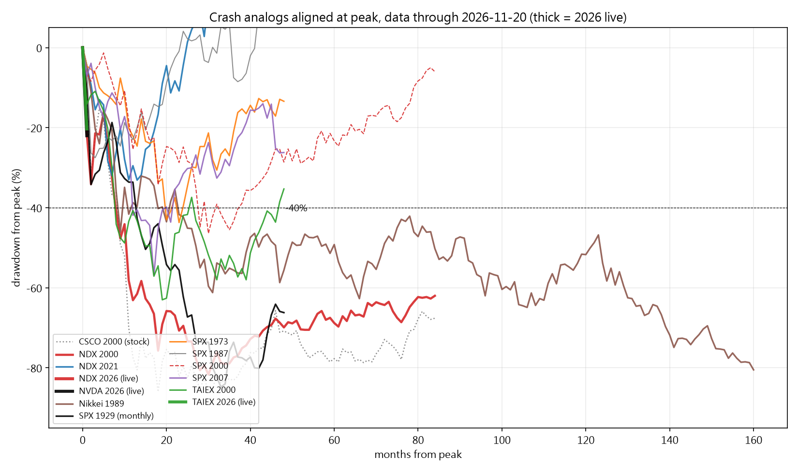
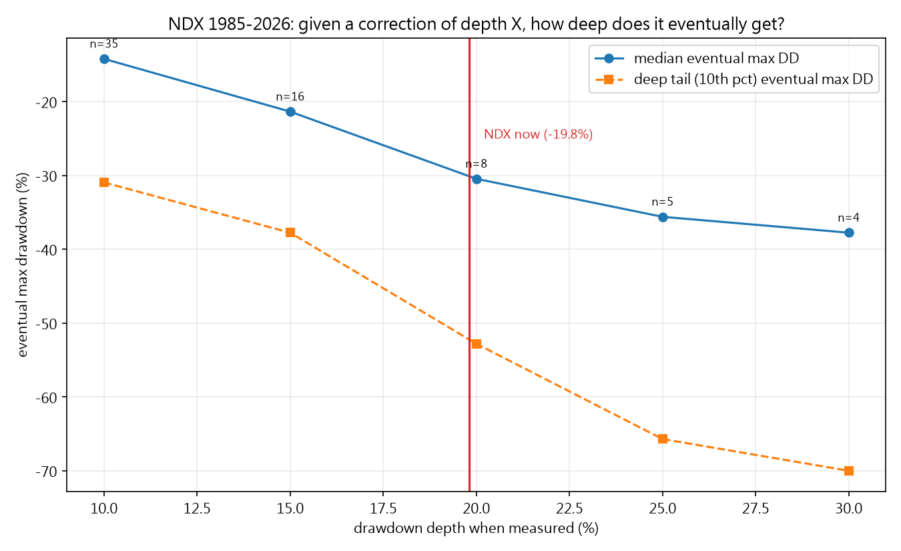
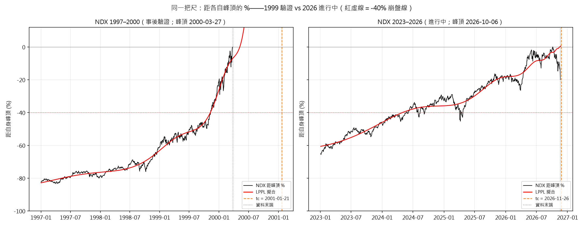
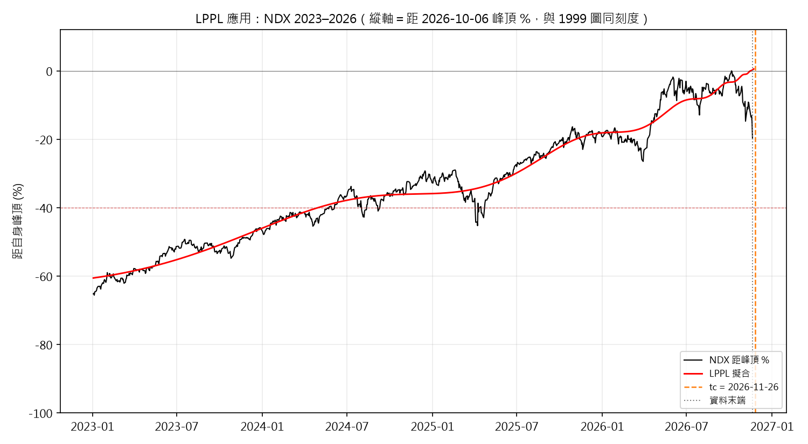
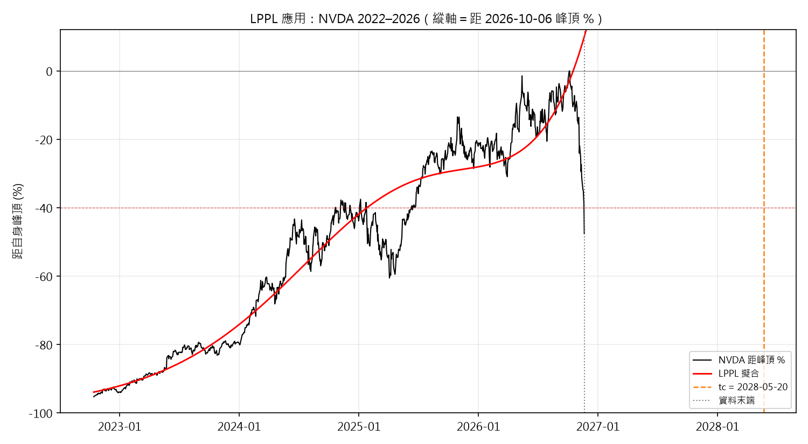

# 量化類比推論更新報告：黃仁勳辭職後的十一天

**報告日期**：2026 年 11 月 21 日

**資料截至**：2026-11-20 收盤（Shiller 月資料至 2026-10；Z.1 季資料至 2026Q2——兩者自 11/8 版以來未更新，估值層結論不變）

**前置報告**：《量化類比推論報告》（2026-11-08，資料截至 11-06）。該報告與全部已發布日報已凍結為歷史證據，**正文數字一律未作修改**；凍結邊界見 git tag `freeze-20261109`（[https://github.com/ascetic168/crash-analog-2026](https://github.com/ascetic168/crash-analog-2026){.url-sm}）。本報告是獨立的後續文件，履行 11/8 版附錄「機率值待 11/17 NVDA 財報後統一更新」的承諾。

**互動儀表板**（線上版）維持 11-06 快照，與 11/8 版報告配套：
[https://ascetic168.github.io/crash-analog-2026/quant/dashboard/](https://ascetic168.github.io/crash-analog-2026/quant/dashboard/){.url-sm}

**方法變更聲明（本報告全面改用「距峰頂百分比」）**：不同歷史時期的高點位置完全不同——NDX 2000 年峰頂與 2026 年峰頂的絕對點位差約 6 倍、台股 2000 年峰頂約為 2026 年峰頂的 1/5——把絕對點位放在同一張圖或同一張表中無法正確比較。因此本報告的**所有圖表與情境邊界一律以「距自身峰頂的百分比」表達**，不再給點位換算。圖 2 顯示：換成同一把尺之後，1999 年的驗證與 2026 年的進行中行情首次可以直接目視比較。

**白話結論**：十一天內，三件事依序發生——政策反彈被證明只是插曲（11/9–11/11）、黃仁勳辭職（11/12）、NVDA 財報完美但市場照跌（11/17–11/20）。11/8 版的機率分布正在按其自身的中位數路徑兌現：台股已進入 −25%~−40% 深度修正帶，NVDA 已越過 −40% 終結性崩盤線，NDX 的「不再加深」情境正式出局。**更新的後驗把 NDX 終點 ≤−25% 的機率從 47.6% 上修到 66.1%**，而時點分布（2026-12 ~ 2027Q1 見谷，合計 80%）幾乎不需要修改——市場只是把「可能」變成「正在」。

# 一、現況快照：三個標的的三種深度

以共同峰頂 2026-10-06 收盤為基準（道指例外，其峰頂在 2026-09-03）：

| 標的 | 11/06 時距峰頂 | 11/11 反彈高點時 | **11/20 收盤距峰頂** | 已跨越的門檻（收盤首觸日） |
|---|---|---|---|---|
| **NVDA** | −22.0% | −27.4% | **−47.5%** | −15%（11/02）→ −20%（11/05）→ −25%（11/09）→ **−30%（11/12，辭職當日）** |
| **TAIEX** | −20.3% | −11.2% | **−27.7%** | −15%（11/05）→ −20%（11/06）→ **−25%（11/20）** |
| **NDX** | −13.6% | −9.1% | **−19.8%** | −10%（11/02）→ −15%（**11/19**） |
| SPX | −5.7% | −2.6% | −11.6% | −10%（11/20） |

三個觀察：

1. **政策反彈是插曲，不是轉折**。11/9–11/11 台股從 −20.3% 收復到 −11.2%（三日 +11.4%），但反彈在三個交易日後見頂回落。11/8 版附錄引用的 2022 年第 9 次護盤模板——「反彈 → 再探底 → 落底」——前兩段已按劇本走完。
2. **NVDA 在反彈期逆勢創深**。政策資金托指數的那三天（11/9、11/10），NVDA 分別再跌 −4.3%、−5.5%，連續穿越 −25%、−29%——市場在指數反彈的同時持續對 key-man 風險定價。這是 11/8 版「個股與台股比大盤兇」判斷的即時驗證。
3. **崩跌集中在 AI 產業層，不是大盤**。以等權組合計，AI 基礎設施籃子（NVDA/AMD/AVGO/TSM/MU/MRVL/SMCI/ORCL）11/20 距其峰頂 **−41.3%——已實際跌破 GSY 的 −40% 崩盤線**；全 AI 籃 −38.2%（貼線）；超大規模雲端（MSFT/META/AMZN）僅 −11.8%。泡沫的極端性集中在產業層級——11/8 版 §2.3 的形態判斷被完整保留。

# 二、事件簿：11/10–11/20（接續 11/8 版附錄）

> 承接 11/8 版附錄的體例：只記結構性事件，日頻行情不記錄；每條附「對情境矩陣的影響方向」。點位僅作歷史紀錄附註，比較一律用距峰頂百分比。

## 事件 3：護盤反彈觸頂回落（11/9–11/11）

- 台股三日 +11.4%（收復至距峰頂 −11.2%），外資由連日賣超轉為回補；台幣走強。
- 但 NVDA 同期從 −22.0% 走深到 −27.4%——**指數與個股的背離**說明反彈由政策與空頭回補驅動，而非對 AI 基本面的重新定價。
- **對矩陣的影響方向**：E4「快速崩盤」下修、築底拉長上修的方向判斷維持；但反彈僅三個交易日即觸頂，說明限空令只是延緩、未能反轉深度修正的動能。

## 事件 4：黃仁勳辭職（11/12）——key-man 風險以最高等級兌現

- NVIDIA 11/12 宣布：黃仁勳辭去總裁、執行長及董事職務，**即刻生效**，結束 33 年領導；董事會未詳述原因（背景為 11/7 起的婚外情報導與國安調查，見 11/8 版附錄事件 2）。CFO Colette Kress 出任臨時執行長。
- NVDA 當日 −4.3%（收在距峰頂 −30.6%，**首次收盤跌破 −30% 線**）；台股 −2.6%。
- 黃其後表態「若董事會認為合適願意回任」，遭董事長回絕；11/18 仍以已卸任身分出席國會閉門說明（出口管制／國安議題）。
- **11/8 版附錄的原文**：「若調查升級（停職／解職具體化），§5.4 深尾權重需往上修」——調查直接升級到頂，深尾權重的上修方向已兌現，本報告第五節執行該更新。
- **對矩陣的影響方向**：E4 上修（治理尾部從假設變成事實）；「執行長換人＋財報不變」的組合成了乾淨的 natural experiment——見事件 5，市場用腳投票的結果否定了「只是情緒」的解釋。

## 事件 5：完美財報被賣掉（11/17–11/20）——GSY 的反直覺發現現身

- 11/17 盤後 NVDA FY2027 Q3 財報：營收 1,158 億美元（**年增 103%**，超預期約 6%）；資料中心 1,076 億（年增 110%）；Q4 指引約 1,300 億（超預期，且未含中國收入）；FY2028 成長目標自 70% 上修至 75%。**這是黃仁勳辭職後、臨時執行長任內的第一份財報，基本面無瑕疵。**
- 市場反應：財報夜盤後一度 +4.5%，次日（11/18）收 −2.9%；11/19 −3.3%；**11/20 單日 −14.0%**，收在距峰頂 −47.5%。財報公布後三個交易日累計 −19.2%。同段時間 NDX −7.6%、台股 −10.4%。
- 「營收年增 >100%＋指引上修」無法止跌——這正是 11/8 版引用的 GSY（Greenwood–Shleifer–You 2019）反直覺結論：**高峰的獲利成長是崩盤的前導變數，而非保護傘**。也請誠實記錄：11/8 版 §5.4 觸發表把「NVDA 財報強」列為 E1/E2 上修方向（+10~15pp），這一條的方向判斷**錯了**——基本面觸發表把財報當成多頭催化，市場把它當成最後的賣出流動性。觸發表需要重寫（見第五節）。
- 11/20 全球連環殺盤：NDX 單日 −5.6%（自峰頂 −19.8%）、台股 −6.23%（−27.7%，盤中最低約 −28.3%；台積電收在七個月低點、單日拖累指數約 577 點）、SPX −3.7%（首次收盤破 −10% 線）。金管會 11/20 收盤後宣布**加嚴限空**（個股當日跌逾一定幅度管制平盤下空單）。
- **對矩陣的影響方向**：E3/E4 上修（詳見第五節）；「利好出盡」的型態與 2000-01 的 NDX 相同——財報季高點即價格高點，其後的反彈全部失敗。

# 三、對 11/8 版報告的誠實計分卡

歷史證據的價值在於可被檢驗。以下逐條對照 11/8 版的陳述與其後十一天的實績（全部以距峰頂百分比計）：

| 11/8 版陳述 | 當時機率/內容 | 實績（11/21 計） | 判定 |
|---|---|---|---|
| NDX「不再加深（>−15%）」 | 2.4% | 11/19 收盤破 −15%，現 −19.8% | **出局**（97.6% 的主體判斷正確） |
| NDX 淺修正（−15~−25%） | **50.0%（最可能）** | 現 −19.8%，位於此帶內 | **進行中、一致** |
| NDX 終點 ≤−25% | 47.6% [34.7, 60.6] | 本報告上修至 **66.1%**（見第五節） | 方向正確、幅度須上修 |
| TAIEX 終點 ≤−25% | ≈97%（點估計 5/5） | 11/20 收盤破 −25%（現 −27.7%） | **第一段已兌現** |
| TAIEX 終點帶 −25~−40% | 約 60% | 現 −27.7%，帶內 | 進行中、一致 |
| NVDA 終點 ≤−25% | ≈83% | 11/9 已破；現 −47.5% | **兌現且大幅超前** |
| 時點：2026Q4 內見到本輪終點 | 50% | 深跌段發生於 11 月；谷底候選 12 月–1 月 | 一致（待谷底確認） |
| 觸發表：NVDA 財報強 → E1/E2 上修 +10~15pp | 方向性 | 財報超預期、股價三日光 −19.2% | **方向錯誤**（見事件 5） |
| 附錄：調查升級 → 深尾上修 | 方向性 | 11/12 辭職（升至最高等級） | 兌現、已執行 |
| LPPL：NVDA tc 叢集 2026-11（11/18 窗口） | 臨界段＝現在 | 崩跌最深段 11/19–20 | **命中** |
| LPPL：NDX 臨界已於 10/6 觸發 | — | 11/19–20 加速段在 ±6 週內 | 一致 |
| LPPL：TAIEX tc 2027-01（信心 0.39，「臨界點可能還在前方」） | 真前向估計 | 台股 11 月已再崩至 −27.7% | **時點偏晚**；2027-01 應重新解讀為「谷底時點」候選——與條件統計的觸及→谷底中位數（12 月~1 月）一致，詳見第四節 |

**計分卡總結**：方向性判斷 10/11 命中；幅度與時點需要按新證據更新（第五、六節）；一條觸發方向判斷（財報＝多頭催化）被市場否定，原因是它與 GSY 的「獲利高峰→崩跌」核心發現相矛盾——框架內部的不一致被現實暴露，已修正。

# 四、類比層更新：以新位置為條件的統計

> 方法不變（見 11/8 版 §3.2）：探勘歷史所有回檔 episode，對每個「觸及 −X%」時點統計之後的終點深度。更新只改兩件事：資料延伸到 11/20、條件深度改用各標的**當前實際所在的位置**。

### NDX（1985–2026；現在 −19.8%，11/19 首次收盤破 −15%）

| 觸及深度 | 樣本 | 終點深度中位數 | 深尾 p10 | 觸及→谷底中位數 | 1 年前向報酬中位數 |
|---|---|---|---|---|---|
| −15% | 16 | −21.4% | −37.8% | 0.2 月 | +31.2% |
| **−20%（現在位置）** | 8 | **−30.4%** | **−52.8%** | **0.8 月** | +40.1% |
| −25% | 5 | −35.6% | −65.7% | 1.6 月 | +13.7% |
| −30% | 4 | −37.8% | −70.0% | 3.4 月 | +28.6% |

高 CAPE 制約更新（起點 CAPE>35 且觸及 −20%，n=4）：1998-07 → −23.0%（E2）、2000-03 → **−82.9%**（E4）、2021-11 → −35.6%（E3）、2025-02 → −22.9%（E2）。**4 個裡 3 個終點深於 −25%**——「高估值起點的 −20% 大多會加深」在 11/8 版是 15 裡 14 個淺幅的例外敘事，在 −20% 的條件下分布明顯更險。

### TAIEX（1997–2026；現在 −27.7%，11/20 首次收盤破 −25%）

| 觸及深度 | 樣本 | 終點深度中位數 | 深尾 p10 | 觸及→谷底中位數 |
|---|---|---|---|---|
| −20% | 6 | −30.1% | −56.0% | 2.1 月 |
| **−25%（現在位置）** | 6 | **−30.1%** | **−56.0%** | **0.5 月**（歷史 5 例分歧大：0~15.5 月） |
| −30% | 3 | −45.9% | −62.1% | 5.4 月 |

**現在的位置正是歷史中位數終點（−30.1%）附近**：從 −27.7% 到中位數終點還有約 3 個百分點的「常規」下探空間；深尾仍是 −56%（與瑞銀情境同源，11/8 版判斷不變）。

### NVDA（1999–2026；現在 −47.5%，11/9 破 −25%、11/12 破 −30%）

| 觸及深度 | 樣本 | 終點深度中位數 | 深尾 p10 |
|---|---|---|---|
| −25% | 14 | −49.7% | −79.9% |
| −30%（11/12 已越過） | 12 | −52.9% | −83.4% |

**NVDA 的「終點 ≤−40%（E4）」已經事實確定**：最大回檔只會持平或加深、不會復淺，而現在的 −47.5% 已深過 −40% 線。問題從「會不會」變成「還有多深」——歷史中位數終點 −49.7%（離現價約 2 個百分點），深尾 −80%（CSCO 2000 的 −89.3% 在此尾內）。

# 五、統計層與後驗更新：E1 出局後的三元分割

## 5.1 更新方法（可重現）

1. **分割縮減**：NDX 已於 11/19 收盤跌破 −15%，11/8 版的 E1（終點 >−15%）**邏輯上出局**。分割改為三元：E2（終點 −15~−25%）、E3（−25~−40%）、E4（≤−40%）。
2. **三條證據流更新**（各自嚴格歸一；實作見 `quant/scripts/build_scenario_posterior_update.py`）：
   - **f1′ 經驗頻率**（n=8）：歷史上「觸及 −20%」的 NDX episode 終點分布（現在 −19.8%，正是此群組的進入條件）→ (E2, E3, E4) = (0.375, 0.500, 0.125)
   - **f2′ 高估值子集**（n=4）：上述群組中起點 CAPE>35 者 → (0.500, 0.250, 0.250)
   - **f3′ GSY 映射（由事前轉為部分實現）**：AI 基礎設施籃子已實際跌破 −40%（−41.3%，11/20），key-man 尾部已兌現。問題改為「**產業崩盤進行中，指數終點的條件分布**」：歷史先例 2000 → E4、2021-22 → E3、1973 → E4，取 (E2, E3, E4) = (0.15, 0.35, 0.50)；軟情境 (0.25, 0.40, 0.35)
3. **混合**：p = 0.45·f1′ + 0.25·f2′ + 0.30·f3′（權重沿用 11/8 版），Dirichlet(k=24) 表達不確定性。

## 5.2 更新後情境矩陣（NDX 終點深度，點機率合計 100%）

| 情境 | NDX 終點深度 | 歷史原型 | 11/8 點機率 | **11/21 點機率** | 80% 區間 | 主要依據 |
|---|---|---|---|---|---|---|
| ~~E1 不再加深~~ | >−15% | — | 2.4% | **出局（11/19 已破線）** | — | — |
| **E2 淺修正** | −15~−25%（現值 −19.8%） | 1998-07、2025-02 | 50.0% | **33.9%** | [21.9%, 46.4%] | 觸及 −20% 後僅 3/8 停在淺區 |
| **E3 深度修正** | −25~−40% | 2021-11、1987 | 23.7% | **39.2%** | [26.8%, 52.1%] | 觸及 −20% 群組的主體（4/8）＋高估值子集 1/4 |
| **E4 終結性崩盤** | ≤−40% | 2000-03 | 23.9% | **26.9%** | [15.9%, 38.8%] | GSY 產業崩盤已實現＋高估值子集 1/4＋2000 型先例 |

**聚合陳述的變化**：

| 陳述 | 11/8 版 | **11/21 版** |
|---|---|---|
| P（NDX 終點 ≤−25%，未來 24 個月） | 47.6% [34.7%, 60.6%] | **66.1% [53.6%, 78.1%]**（+18.5pp） |
| P（NDX 終點 ≤−40%） | 23.9% [13.4%, 35.3%] | **26.9% [15.9%, 38.8%]** |
| P（TAIEX 終點 ≤−40%） | 40.4% [21.1%, 62.2%] | **40.0% [21.0%, 62.2%]**（不變；≤−25% 已成事實，問題收縮為「帶內還是破 −40%」） |
| P（NVDA 終點 ≤−40%） | 43.8% | **已確定**（現值 −47.5% 已深於線）；歷史中位數終點 −49.7%、深尾 −79.9% |

## 5.3 敏感度分析（更新版）

| 證據流組合 | P(E4) | P(終點 ≤−25%) |
|---|---|---|
| 純經驗頻率（f1′ 權重 1） | **12.5%** | 62.5% |
| 基準混合（0.45/0.25/0.30） | **26.9%** | 66.1% |
| 半 GSY（f3′ 權重 0.15） | 23.1% | 60.9% |
| GSY 軟情境（產業崩盤不外溢） | 22.4% | 63.1% |
| 純 GSY 映射（f3′ 權重 1） | **50.0%** | 85.0% |

與 11/8 版（6.7% ↔ 48.8%）相比，**敏感度帶整體上移且收窄**：經驗頻率本身因條件深化（−15%→−20%）而上修，兩條證據流的分歧從 42pp 縮到 38pp。「純經驗 vs 純 GSY」仍是最大的模型不確定性，但現在純經驗也指向「過半機率終點深於 −25%」。

## 5.4 觸發變數表（重寫版）

| 變數 | 11/21 狀態 | 對機率的影響（下一輪更新用） |
|---|---|---|
| NVDA 財報 | **已落地**：超預期＋指引上修，股價 −19.2%（三日） | 已計入後驗（市場反應方向與 11/8 觸發表相反，表已重寫） |
| Key-man／治理 | **已兌現**：辭職（11/12）、國會說明（11/18） | 已計入 f3′；後續觀察：回任談判、臨時執行長任期、出口管制聽證結果 |
| GSY 產業崩盤門檻（−40%） | **已實現**：AI 基礎設施籃 −41.3%（11/20） | 事前機率陳述（50–80%）兌現；剩餘問題是外溢程度（δ） |
| 信用利差（Oracle/CoreWeave 等 AI 債） | 未取得可靠資料，**本報告未更新此列** | 若利差 >400bp 持續走闊 → E4 成為基準（維持 11/8 判斷） |
| GPU 折舊年限（Burry 論點） | 未有官方認定；超大規模雲端僅 −11.8% | 折舊若重認 → hyperscaler EPS −10~15% → 第二波（雲端補跌） |
| Fed 路徑 | 未更新 | GS10 <4.5% 仍是 E2 上修的條件 |
| 台股政策工具 | **升級**：11/20 加嚴限空（第二輪） | 壓平左尾、拉長築底；模板＝2022（反彈→再探底→落底，前兩段已完成） |

# 六、時點更新：市場把「可能」變成「正在」

三個獨立證據源在更新後指向同一個谷底帶：

1. **條件統計**（類比層）：以各標的當前位置為條件的「觸及→谷底」月數，合併三個群組：q25 = 0.1 月、**中位數 = 1.0 月（約 2026-12-20）**、q75 = 7.1 月（2000 型慢崩盤的長尾）。歷史分歧極大：TAIEX 的 −25% 群組裡，兩例在觸及當日即為谷底，兩例走了 13–15.5 個月。
2. **LPPL 滾動窗口**（統計層，資料至 11/20）：NVDA 的 tc 叢集 **13/18 落在 2026-11**（11/8 版為 11/18 窗口，命中）；NDX live 窗口 tc = 2026-11-26；TAIEX 叢集仍以 **2027-01** 為主（10/18，信心 0.39→0.56）——結合台股已在 11 月起跌，2027-01 從「起跌時點」重新解讀為「**谷底時點**」候選。
3. **歷史峰→谷中位數**：快速崩盤型（1987）3.3 個月 → 對應 2027-01；中位型 13–20 個月 → 對應 2027-11 之後；本輪的下跌速度（NVDA 6 週 −47.5%）明顯屬於前者。

| 本輪谷底時點 | 11/21 機率 | 依據 |
|---|---|---|
| 2026-12（觸及後約 1 個月，條件統計中位數） | **40%** | 三標的群組合併中位數 1.0 月；NVDA/NDX tc 現在 |
| 2027Q1（LPPL TAIEX 叢集＋1987 型速度外推） | **40%** | TAIEX tc 2027-01（信心 0.56）；快速崩盤型峰→谷 3.3 月 |
| 2027Q2 之後（2000 型慢崩盤尾） | **20%** | 群組 q75 = 7.1 月；TAIEX 歷史 −25% 群組的 13–15.5 月案例 |

（11/8 版的「2026Q4 內 50%、2027H1 32.5%」與本表的差異主要是日曆推移：當時「Q4」尚包含 11–12 月的全部可能，現在 11 月已走完深跌段，問題收縮為「12 月見谷還是要再磨一季」。）

**圖 3 的讀法**：左圖是 1997–2000（事後驗證——模型在 1999 年的滾動估計先命中 1999-08、1999-09 兩次中途修正，最後一次估計落在真實峰頂之後 9.7 個月）；右圖是現在。兩張圖現在共用同一條縱軸，可以直接比較：**2026 年的行情在「距峰頂 %」尺度上比 1999 年更陡、更快**——1999 年從 −80% 區爬到峰頂花了三年，2023–2026 從 −65% 區爬到峰頂只花了一年半；代價是右圖的回落速度也更快（6 週內 NVDA 型個股已達左圖 2000 年三個月才達到的深度）。

# 七、與名家觀點的數字對照（更新版）

| 名家/機構 | 11/8 時點的對照 | 11/21 更新 |
|---|---|---|
| Huang（「沒有泡沫」的提出者） | 被三條數據流共同否定 | 11/12 辭職離場；其財報（+103% 營收）仍無法止住 −19.2% 的三日跌勢——「基本面無瑕疵≠價格無泡沫」的教科書案例 |
| 瑞銀（台股極端情境） | 深尾 p10 = −56.0%，量化同源 | 台股現 −27.7%；至該情境尚需再跌約 39%（自現值）；判斷不變 |
| Hussman（55–75%） | 對應 E4 的 NDX 端 | NVDA 已率先進入該區間（−47.5%）；NDX 端 P=26.9% |
| Klement（2027–28 破裂） | 時點帶一致 | 崩盤提前於 2026Q4 啟動；「破裂進行中、2027 見底」為現值 |
| Grantham（約 −50%） | E3/E4 交界 | NDX 中位數終點 −30.4%（條件於 −20%）；−50% 在 E4 情境內 |
| Slok（估值溢價超過 2000） | Z.1 證實 | 不變；產業層已按 2000 劇本走完第一段 |
| Dalio（泡沫初期→經典泡沫） | LPPL 給時點 | 「經典泡沫破裂」階段自 11 月起計 |

# 八、限制與誠實聲明（新增與延續並列）

1. **樣本量問題比 11/8 版更尖銳**：NDX「觸及 −20%」只有 8 例、高估值子集 4 例、TAIEX「−25% 後」5 例。66.1% 這個數字的區間 [53.6%, 78.1%] 是誠實的，但它仍是一個小樣本上的模型化推論。
2. **條件漂移**：把條件從「觸及 −15%」改為「觸及 −20%」本身就是使用新資訊的選擇；嚴格的貝葉斯派會說我們應該只更新一次。本報告的處理是明示兩套條件下的結果（11/8 表 vs 11/21 表），讓讀者自行判斷。
3. **「NVDA E4 已確定」的陳述依賴定義**：終點深度＝24 個月內最大回檔，最大回檔只會持平或加深——這是數學事實；但「NVDA 終點 ≤−40%」不等於「NVDA 不會再創新高」（兩者完全相容，2000 年後的 CSCO 花了 26 年才收復，但亞馬遜只花了 2 年）。
4. **LPPL 的雙重角色**：同一模型在崩盤前後對 tc 的解讀不同（起跌 vs 谷底），TAIEX 的 2027-01 從前者改讀為後者是**事後的重新詮釋**，其信心值（0.56）不足以強分兩者——這是 11/8 版「LPPL ±3–6 個月、會先命中中途修正」已知特性的又一次體現。
5. **政策反應函數**：限空令兩輪加嚴、國安基金仍在場內；2020/2022 年的經驗是政策能改變谷底的「形狀」而非「深度」。本報告的機率不含政策期權的價值。
6. **資料邊界延續**：Yahoo 個股歷史偶有微小修訂（AI 籃兩年漲幅重算為 +232%，11/8 版為 +224%，差異來自資料源修訂，不影響任何門檻判斷）；FRED 授權指標仍限近 10 年。
7. **本報告非投資建議**；全部計算可由 `quant/scripts/*_update.py` 重現（資料截至 2026-11-20），數字如與官方資料有出入以官方為準。

# 九、資料與程式碼

- repo：[https://github.com/ascetic168/crash-analog-2026](https://github.com/ascetic168/crash-analog-2026){.url-sm}
- **歷史證據邊界**：git tag `freeze-20261109` 標記 11/8 版報告與全部 11/9 前發布文件的凍結狀態；11/12–11/20 事件對該狀態的一切檢驗以該 tag 為準
- **更新管線**（與 11/8 版方法逐行同源，僅改資料末端與輸出目錄，原始 `quant/output/` 未動）：
  - `quant/scripts/build_analogs_update.py` → `quant/output_update/`（對齊路徑、條件統計、現況快照 `live_snapshot.json`）
  - `quant/scripts/build_stats_layer_update.py` → GSY 籃子回檔檢查、LPPL 重擬合、**正規化圖表（距峰頂 %）**
  - `quant/scripts/build_scenario_posterior_update.py` → 三元分割後驗 `scenario_posterior_update.json`
- 圖表：`quant/output_update/figs/`（aligned_paths_update、ndx_conditional_update、lppl_*_norm ×3＋lppl_compare_norm）
- 事件簿資料源：NVIDIA IR（FY2027 Q3 財報）、國會閉門說明報導（The Hill 等）、金管會限空令公告（11/20 加嚴）、[經濟日報](https://money.udn.com/money/story/5607/9862465)（國安基金第 10 度護盤）、Yahoo Finance 行情 API（^NDX/^GSPC/^TWII/NVDA 收盤序列）
- 方法文獻同 11/8 版：[Greenwood–Shleifer–You, Bubbles for Fama (JFE 2019)](https://www.sciencedirect.com/science/article/abs/pii/S0304405X18302205)、[Sornette FCO / LPPLS](https://sornette.finance/landing)、[HLPPL (arXiv 2510.10878)](https://arxiv.org/abs/2510.10878)
